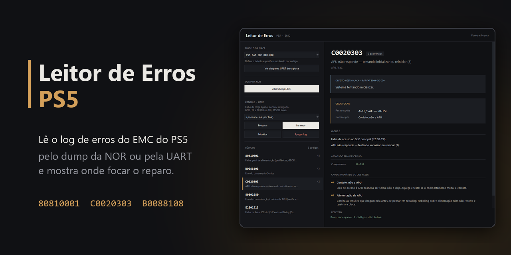
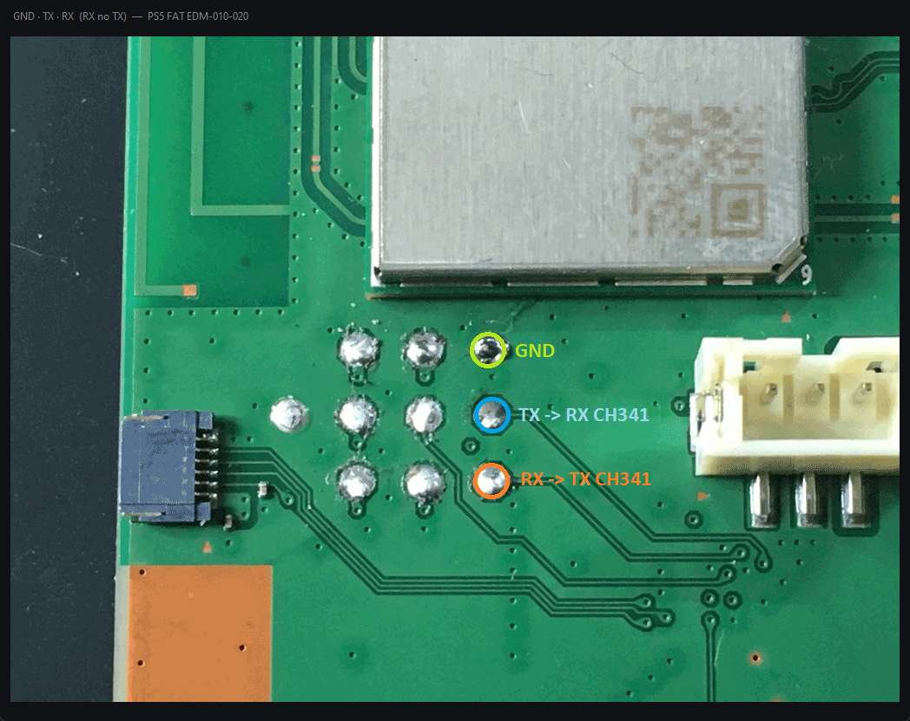
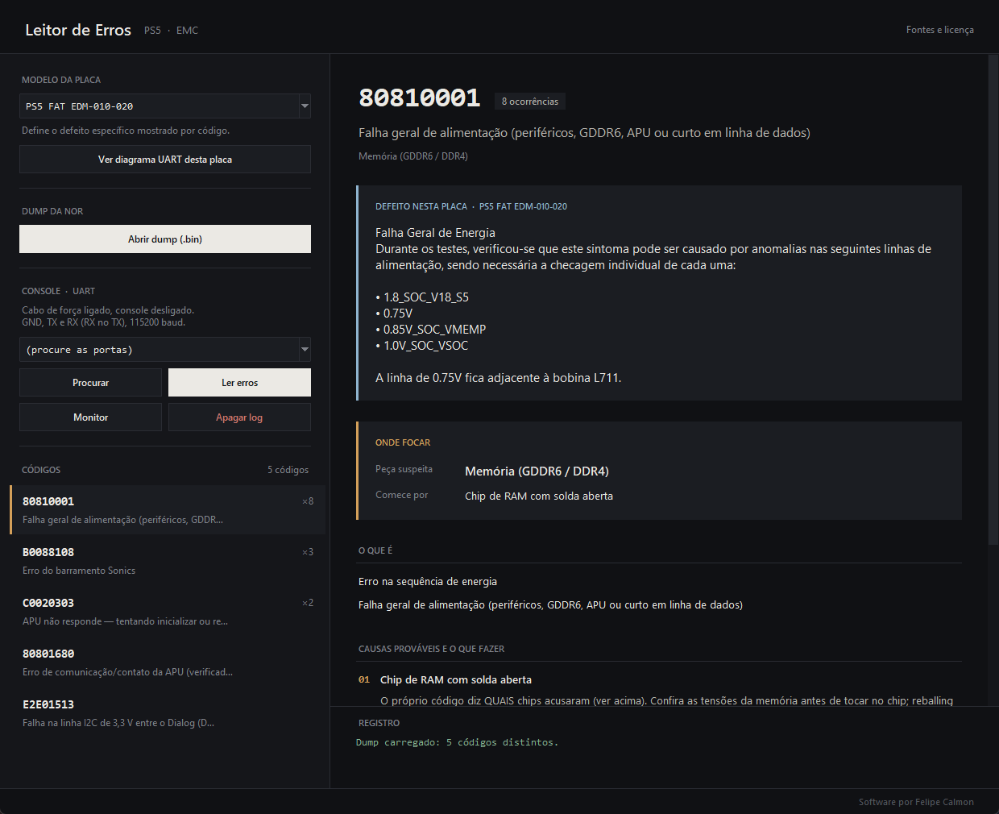
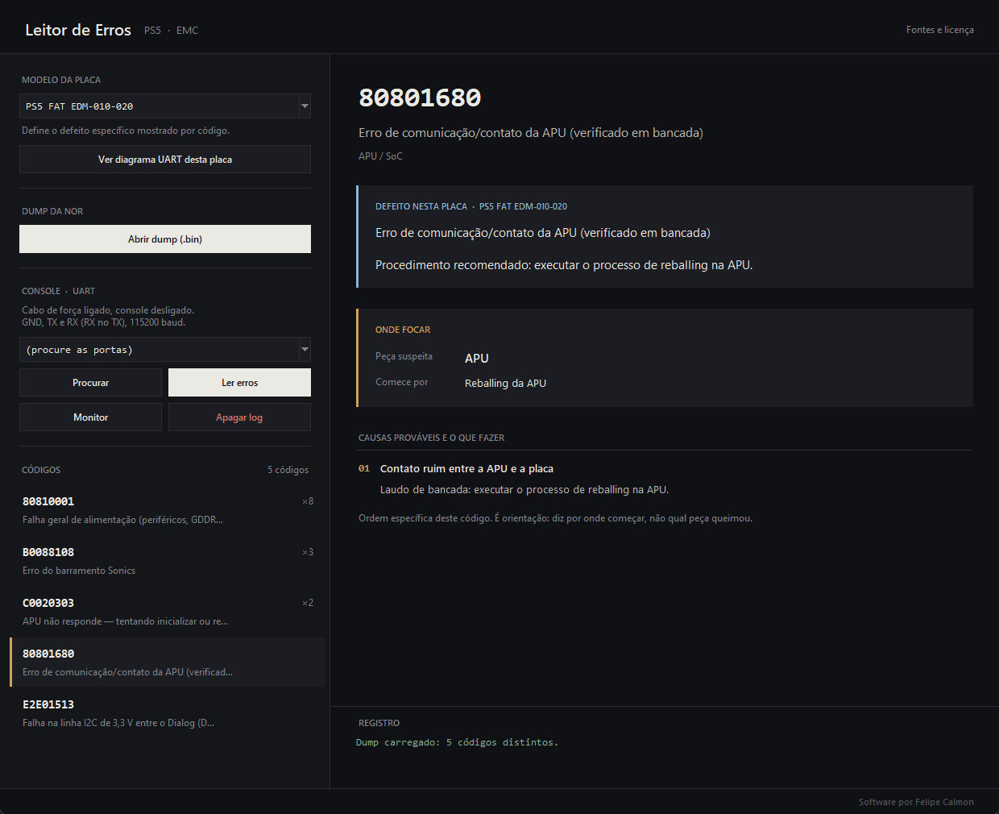
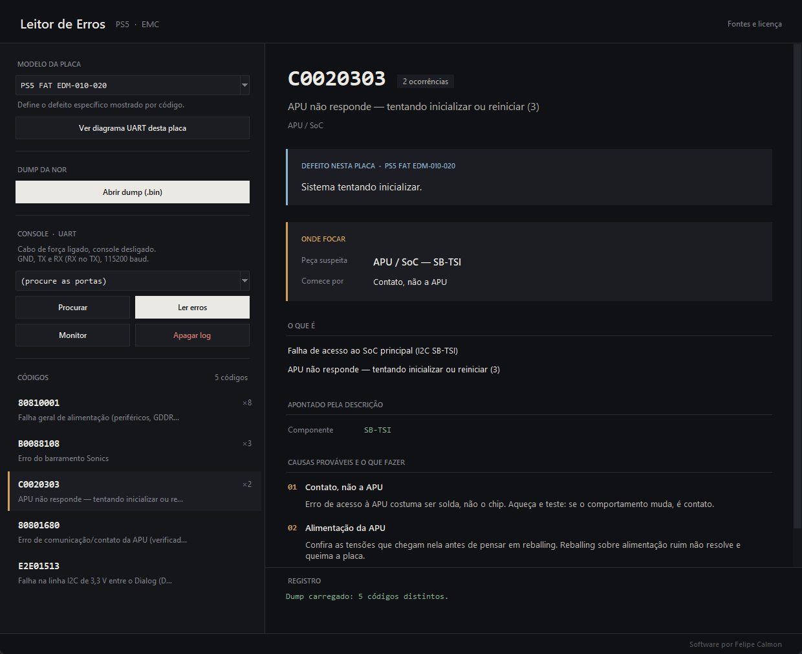

  

# Leitor de Erros PS5

Programa de bancada que lê o **log de erros do EMC** do PlayStation 5 e diz, em
português, **o que o código significa, onde focar o reparo e quais as causas mais
prováveis**. Lê direto do **dump da NOR** ou pelo console, via **UART**.

> Para assistência técnica. Funciona sem instalar nada, com a base de códigos sempre atualizável.

  <a href="../../releases/latest"><b>⬇️ Baixar o programa (Windows)</b></a>

---

## Duas formas de ler

### 📄 Leitor de log do EMC (dump da NOR)

Abra o dump de 2 MB (`.bin`) e o programa lista todos os códigos de erro gravados
no log do EMC, do mais frequente para o menos. Clique em um código e veja o laudo.

### 🔌 Leitor de UART

Com o console desligado e o cabo de força ligado, conecte GND, TX e RX a um adaptador
USB-serial e leia o log direto da placa, a 115200 baud.

- **Procurar** acha as portas COM.
- **Ler erros** puxa o log do EMC.
- **Monitor** acompanha a saída ao vivo.
- **Apagar log** limpa o log do EMC depois do reparo.

O botão **Ver diagrama UART desta placa** abre a foto da placa com os pontos GND, TX e
RX marcados.

  

---

## O que aparece para cada código

  

- **Onde focar:** a peça suspeita e por onde começar o reparo.
- **O que é:** a descrição do código, traduzida e limpa.
- **Causas prováveis e o que fazer:** em ordem, do que é comum e barato de conferir
  até o que exige mexer no chip.
- **Defeito nesta placa:** o defeito específico daquele código para o modelo escolhido,
  com as linhas de tensão a verificar.
- **Onde apareceu:** em quais registros o código foi gravado, com a temperatura do SoC
  quando o registro traz.

  
  

### Modelos de placa

| Modelo |
|---|
| PS5 FAT EDM-010-020 |
| PS5 FAT EDM 030 |
| PS5 SLIM EDM 040 |
| PS5 PRO VSM 010 |

Escolha o modelo da placa no topo da tela para ver o defeito específico dele.

---

## Como usar

1. Baixe o `Leitor_Erros_PS5.exe` na aba **[Releases](../../releases/latest)**.
2. Escolha o **modelo da placa**.
3. **Abrir dump (.bin)** para ler uma NOR, ou use o bloco **Console · UART** para ler pelo
   console. Os códigos aparecem só a partir da leitura.
4. Clique em um código da lista para ver o laudo.

## Requisitos

- Windows, sem instalar nada. Funciona sem internet; com internet, o programa confere ao abrir se há códigos novos e os baixa sozinho.
- Para a UART: adaptador USB-serial (CH341) e solda ou ponta de prova nos pontos
  GND, TX e RX da sua placa.

## Aviso do Windows na primeira vez

O `.exe` não é assinado digitalmente, então o **SmartScreen** pode mostrar
"O Windows protegeu o computador". É normal para programas pequenos. Para abrir, clique
em **Mais informações → Executar assim mesmo**.

## Observações

- É uma **orientação**, não um diagnóstico: o código diz onde o console tropeçou, não
  qual peça queimou. Meça antes de aquecer ou trocar chip.
- Códigos que não estão na base aparecem como "não catalogado" ou "pouco documentado".
- A origem dos dados e as licenças estão no botão **Fontes e licença**, dentro do programa.
